<h1 align="center">sbx</h1>

<p align="center">
  <b>Build, run and connect containers, each in its own microVM.</b><br>
  Docker's commands for the everyday loop: build an image, run it, start a database next to it.<br>
  Every container and every build stage gets its own kernel, and the network is closed until you open it.
</p>

<p align="center">
  <a href="https://github.com/toollyst/sandbox/releases/latest"></a>
  <a href="https://github.com/toollyst/sandbox/actions/workflows/ci.yml"></a>
  <a href="#license"></a>
  
  
  <a href="https://scorecard.dev/viewer/?uri=github.com/toollyst/sandbox"></a>
</p>

> [!WARNING]
> **`sbx` is 0.x.** It works end to end on real VMs and is maintained from 0.2 on, but it has not had an outside
> security audit. Until 1.0, a minor release (0.3, 0.4, …) may change commands, flags, the on-disk layout or the
> executor protocol, only after a deprecation and always listed in the [CHANGELOG](CHANGELOG.md)
> ([COMPATIBILITY.md](COMPATIBILITY.md)). Read [SECURITY.md](SECURITY.md) for what it does and doesn't defend
> against before you trust it with anything that matters.

<p align="center">
  
</p>

<p align="center"><sub>A real recording on an Apple Silicon Mac (<code>cargo xtask demo</code>). Every command ran for real and the
output appears when it actually arrived. Only the typing is simulated.</sub></p>

`sbx` is a command-line tool for the core of what people use Docker Desktop for: building images from a Dockerfile,
running them, and running development services such as a database next to your app. It takes Docker's command and
flag names and runs the same OCI images, from Docker Hub, GHCR or your own registry. What is different is underneath:

- **Every container is its own microVM**, with its own Linux kernel behind hardware virtualization (KVM on Linux,
  Hypervisor.framework on macOS).
- **Builds run in VMs too.** `sbx build` runs each stage's `RUN` steps in a microVM of its own, so a package's install
  script runs behind the same boundary as anything else you run.
- **The network is closed until you open it.** The VMs have no network device. A sandbox or a build reaches the
  `host:port` pairs you allow, and one sandbox reaches another only on the port you connect (`--connect db:5432`).
  The host enforces both.

It is also made for running code you don't trust, such as **AI agents** (with a built-in [MCP server](docs/guide/mcp.md)),
user-submitted code and CI jobs. It is not all of Docker Desktop: there is no GUI (there is a terminal UI,
`sbx tui`), no Compose yet, no Kubernetes, no extensions, no Docker Engine API socket and no emulation of other CPU
architectures. (Docker's own Docker Sandboxes also has a CLI named `sbx`; this is a different project,
[see below](#not-docker-sandboxes).)

## What we're after

- **A real boundary for code you didn't write.** Every sandbox and every build stage is a VM with its own kernel.
  Containers on one machine share a kernel; sandboxes don't.
- **Nothing in the way.** No daemon, no root, no account. On macOS it needs no privileges at all.
- **Offline unless you say so.** You allow `host:port` pairs one by one, for `run` and `build` alike, and programs
  that ignore proxy settings go through the same list. A name you didn't allow isn't even looked up.
- **Docker muscle memory.** `build`, `run -it`, `-d`, `-p`, `-v NAME:/path`, `exec`, `cp`, `logs -f`, `ps -aq`,
  `push`, `volume`, `save`/`load` and exit codes 125/126/127 behave the way you expect, on the same OCI images,
  unmodified. Your registry credentials, mirrors and signature policy come from the files Docker and Podman already
  read.
- **Open standards, not one VMM.** `sbx` has no hypervisor built in. It talks to an **executor** over a documented
  [protocol](crates/spec/executor-proto/src/lib.rs), installs executors from static repositories that follow an
  [open spec](crates/spec/executor-repo/src/lib.rs), and runs whatever you installed. An executor is either one
  program or a VMM package run by an adapter. The default executor is `wick`, our Firecracker build, under the
  `firecracker` adapter; you can install another, write your own or publish your own repository, and `sbx` treats
  them exactly like ours ([executors](docs/guide/executors.md)).
- **Mechanism, not policy.** `sbx` holds the line you draw (the allow list, which ports a sandbox may connect to,
  CPU and memory, which sandboxes an agent can see) and leaves the drawing to you.
- **Checkable.** Releases are signed (minisign and Sigstore) and come with build provenance and an SBOM;
  `sbx upgrade` checks the signatures. Executor repository and release indexes are signed against tampering,
  rollbacks and frozen mirrors. The [threat model](SECURITY.md#threat-model) says what is covered and what isn't yet.

## What works, and what doesn't yet

<!-- compat:begin -->
**Compatibility:** of the commands, flags and features that apply to a VM, sbx does 59% (146 of 244) of the Docker CLI's, 39% (131 of 332) of Podman's, 54% (128 of 237) of nerdctl's, 63% (21 of 33) of the Dockerfile, 0% (0 of 62) of Compose and 77% (7 of 9) of the product features of Docker Desktop and its alternatives. [The table](docs/guide/tool-compatibility.md) gives every row, its difference and its test, and CI keeps it in step with the code.
<!-- compat:end -->

- **Works:** pulling, running and managing containers (`run`, `exec`, `cp`, `logs`, `stats`, `-p`), `build` with a
  layer cache and `--output` to sbx, Docker, an OCI archive or a registry, `tag` and `push`, named volumes,
  `--connect` between sandboxes, the allow list with transparent TCP, `--format json` and `--jq`, `events`, `sbx tui`
  and the MCP server.
- **Not yet:** `sbx compose` (planned after 0.3). Live sharing of a host folder (`-v ./src:/app`) works only with an
  executor that announces it (virtio-fs); the default one doesn't yet, so copy a folder in with
  `--mount type=copy` meanwhile. In a Dockerfile, `RUN --mount`, heredocs, `ADD` of an archive or URL and `ONBUILD`
  are errors with the line number, never ignored. Only TCP goes out of a sandbox (names are answered through the
  host); there is no UDP. Windows installs but has no executor to run sandboxes yet.

`cargo xtask bench` on an Apple Silicon Mac, measured on 2026-11-09 before 0.2, 1 vCPU and 512 MiB per sandbox:
`sbx run --rm alpine:3.20 true` (boot, run, shut down, delete) took **121 ms** at p50, `sbx exec` into a running
sandbox **8 ms**, and ten runs at once finished in **0.50 s**. Try it on your machine ([source](xtask/src/bench.rs)).

<!-- build-timings: the build comparison with docker build (cargo xtask bench build, roadmap D6) goes here, measured on a
real VM, with the machine and the date. No numbers until then. -->

## Install

> [!NOTE]
> This `sbx` doesn't carry the official executor repository's signing key yet, so it doesn't install an executor by
> itself, and the installer doesn't pin one. Install one by hand after `sbx`: `sbx executor search` lists what the
> configured repositories offer and `sbx executor install NAME` installs it, or install one from a directory
> ([install guide](docs/guide/install.md#the-executor)).

The installer puts `sbx` and `sbx-shim` in your OS's place for user programs (`~/.local/bin`, or
`%LOCALAPPDATA%\Programs\sbx` on Windows) after checking their SHA-256 (and their Sigstore signature when `cosign` is
installed), then installs the executor its version pins. With no executor installed, the first `run`, `create`,
`start` or `build` installs the default executor from the signed official repository by itself and says so; any
executor that speaks the protocol can take its place ([executors](docs/guide/executors.md)). Later, `sbx upgrade`
moves `sbx` to the newest signed release, and `sbx` tells you when one is out (`SBX_NO_UPDATE_CHECK=1` turns that
off).

### macOS

macOS 15 or later on Apple Silicon. No setup needed.

```sh
curl -fsSL https://toollyst.github.io/sandbox/install.sh | sh
sbx info                         # check it worked
```

### Linux

x86_64 or aarch64 with KVM (bare metal, or a VM with nested virtualization), and read-write access to `/dev/kvm`:

```sh
sudo usermod -aG kvm "$USER"     # if `ls -l /dev/kvm` shows you can't use it; then log out and back in
curl -fsSL https://toollyst.github.io/sandbox/install.sh | sh
sbx info                         # says what's missing if /dev/kvm isn't usable
```

The binaries are static, so any distribution works.

### Windows

Windows 10 or later on x86_64, in PowerShell. No administrator rights needed:

```powershell
irm https://toollyst.github.io/sandbox/install.ps1 | iex     # sbx.exe into %LOCALAPPDATA%\Programs\sbx
sbx info
```

`sbx` on Windows can `pull`, `prepare` and list images, but there is no tested executor for Windows yet, so it can't
run sandboxes.

Installer options (`SBX_VERSION`, `SBX_INSTALL_DIR`, `SBX_VERIFY`, `SBX_EXECUTOR=none`), installer versions, building
from source, upgrading and uninstalling are in the [install guide](docs/guide/install.md).

## Quick start

An app image built from a Dockerfile, a postgres database whose data lives in a volume, and the app connected to
the database's port and nothing else. Save this as `Dockerfile` in an empty directory:

```dockerfile
FROM alpine:3.20
RUN apk add --no-cache postgresql16-client
ENV PGHOST=db PGUSER=postgres
CMD until psql -c 'select 1' >/dev/null 2>&1; do sleep 1; done; psql -tAc 'show server_version'
```

Then:

```sh
sbx build -t app .        # fails: RUN steps have no network, and sbx names the host the step tried to reach
sbx build -t app --network allow --allow dl-cdn.alpinelinux.org:443 .

sbx run -d --name db -v pgdata:/var/lib/postgresql/data -e POSTGRES_PASSWORD=dev postgres:17
sbx run --rm --connect db:5432 -e PGPASSWORD=dev app     # waits for postgres, then prints its version

sbx rm -f db              # the sandbox goes; the volume pgdata keeps the data for the next db
```

The build stage, the database and the app each ran in a microVM of their own. Inside the app, `db` resolves to a
stand-in address that reaches port 5432 of the `db` sandbox and nothing else; the database's sandbox has no way out
at all. More to try:

```sh
sbx run --rm -it alpine sh                           # an interactive shell
sbx run -d --name dev alpine sleep 600               # detached; then:
sbx exec -it dev sh
sbx cp dev:/etc/alpine-release .
sbx run --rm --network allow --allow pypi.org:443 --allow files.pythonhosted.org:443 \
    python:3.12-alpine pip install requests          # only these two hosts are reachable
sbx tui                                              # sandboxes, images, volumes, events and executors on one screen
claude mcp add sbx -- sbx mcp                        # give an AI agent (here Claude Code) its own machines
```

| Guide | |
| --- | --- |
| [Use it like Docker](docs/guide/usage.md) | Sandboxes, files and live sharing, volumes, the allow list and transparent TCP, connecting sandboxes, images, push, `sbx build` and its cache, `--format json`, `events`, `sbx tui` |
| [Compatibility with Docker, Podman and nerdctl](docs/guide/tool-compatibility.md) | Every command and flag of Docker, Podman and nerdctl, every Dockerfile instruction and Compose key, the features of Docker Desktop and its alternatives, and what sbx does with each |
| [AI agents (MCP)](docs/guide/mcp.md) | Tools, limits, and what an agent can and can't reach |
| [Executors](docs/guide/executors.md) | The executor protocol, adapters and VMM packages, versions the nvm way, bringing your own VMM, signed repositories |
| [Install](docs/guide/install.md) | Per OS, installer options, from source, upgrade and uninstall |

## Platforms

Any executor that speaks the protocol runs anywhere it can start a VM. These are the ones tested here:

| Host | Tested VMM | Status |
| --- | --- | --- |
| macOS 15+, Apple Silicon | Firecracker on Hypervisor.framework ([wick](https://github.com/toollyst/wick)) under the `firecracker` adapter | Works. Real-VM checks run on a Mac, since CI's macOS runners can't start guests |
| Linux x86_64 | Upstream Firecracker on KVM under the `firecracker` adapter | Works. Real VMs boot in CI on every push and before every release |
| Linux aarch64 | Upstream Firecracker on KVM under the `firecracker` adapter | Released and unit-tested on arm; CI's arm runners have no KVM, so there is no real-VM run in CI yet |
| Windows 10+, x86_64 | – | Installs (`install.ps1`); `pull`, `prepare` and `images` work. No tested executor yet, so no sandboxes |

## How it works

`sbx` pulls the image and turns each layer into a read-only EROFS disk in pure Rust (no `mkfs`, no loop device, no
`sudo`), shared by every image that has that layer. Then it asks the executor for a VM. Inside, a small init embedded
in `sbx` stacks the layers under a per-sandbox writable disk and serves exec, file copy, the allow list and
connections between sandboxes over vsock. A build runs each stage's `RUN` steps in such a VM and copies each step's
changes out as a new layer. The [developer docs](docs/developers/) follow one `sbx run` from the CLI to the guest and
back, then `sbx build`, and map every crate.

## Development

```sh
cargo test --workspace --all-features   # unit, conformance, CLI end to end (no VM), links in the docs
cargo xtask check-deps                  # dependency direction between and inside crates
cargo xtask dist && cargo xtask smoke   # checks on real VMs
```

Start with the [developer docs](docs/developers/). The design notes and [roadmap](docs/roadmap.md) in `docs/` and
the per-crate rules in each crate's docs are written in Korean.

## Not Docker Sandboxes

Docker's [Docker Sandboxes](https://docs.docker.com/ai/sandboxes/) also ships a CLI named `sbx`, and the two are
unrelated. Docker Sandboxes is a Docker product for running coding agents in microVMs. This `sbx` is an independent
open-source project: a Docker-style CLI and MCP server that builds and runs any OCI image in its own microVM, with no
account, daemon or root, and with VMMs plugged in through an open executor protocol.

## Contributing and security

Bug reports, benchmark numbers from your machine and executors for other VMMs are all welcome: see
[CONTRIBUTING.md](CONTRIBUTING.md). Please report vulnerabilities privately, as [SECURITY.md](SECURITY.md) describes.
It also spells out the threat model: what `sbx` defends against, and what it doesn't.

## License

Licensed under either of [Apache License 2.0](LICENSE-APACHE) or [MIT license](LICENSE-MIT), at your option.
