<h1 align="center">sbx</h1>

<p align="center">
  <b>Run any Docker image in its own microVM.</b><br>
  The commands you already know. A real kernel boundary. About 120 ms from <code>run</code> to done.
</p>

<p align="center">
  <a href="https://github.com/toollyst/sandbox/releases/latest"></a>
  <a href="https://github.com/toollyst/sandbox/actions/workflows/ci.yml"></a>
  <a href="#license"></a>
  
  
  <a href="https://scorecard.dev/viewer/?uri=github.com/toollyst/sandbox"></a>
</p>

> [!WARNING]
> **`sbx` is alpha.** It works end to end on real VMs, but commands, flags, the on-disk layout and the executor
> protocol may still change without notice, and it has not had an outside security audit. Read
> [SECURITY.md](SECURITY.md) for what it does and doesn't defend against before you trust it with anything that
> matters.

```sh
curl -fsSL https://toollyst.github.io/sandbox/install.sh | sh
sbx executor install wick          # or any executor: sbx runs whatever speaks its open protocol
sbx run --rm -it python:3.12-alpine python
```

<p align="center">
  
</p>

<p align="center"><sub>A real recording on an Apple Silicon Mac (<code>cargo xtask demo</code>). Every command ran for real and the
output appears when it actually arrived. Only the typing is simulated.</sub></p>

`sbx` takes an OCI image from Docker Hub, GHCR or your own registry and boots it in a
[Firecracker](https://firecracker-microvm.github.io/) microVM with its own Linux kernel, behind hardware virtualization.
It is made for running code you don't trust: **AI agents** (with a built-in [MCP server](#give-your-ai-agent-a-computer)),
user-submitted code, CI jobs and plugins.

- **No daemon, no root, no account.** One binary and no background service. On macOS it needs no privileges at all.
- **Offline by default.** The VM has no network device. You allow `host:port` pairs one by one, and the host enforces them.
- **Docker muscle memory.** `run -it`, `-d`, `exec`, `cp`, `logs -f`, `ps -aq`, `--name`, `--env-file` and exit codes
  125/126/127 behave the way you expect.

## sbx next to a container

|  | `docker run` | `sbx run` |
| --- | --- | --- |
| Isolation | Namespaces and cgroups on the **host kernel** | A **separate kernel** behind KVM or Hypervisor.framework |
| Network | A bridge network, on by default | **No network device.** Opt in per `host:port`, checked on the host |
| Root filesystem | Writable layer over the image | Read-only EROFS image under a **per-sandbox disk** |
| Runs as | A long-running daemon, usually root | Your user. Per sandbox: the VMM, plus a small `sbx-shim` when detached |
| Images | OCI | The same OCI images, unmodified |
| Commands | `docker …` | `sbx …`, with the same names and flags |

Containers are great at packaging. Sharing a kernel with code you didn't write is the part `sbx` replaces.

## Numbers

`cargo xtask bench` on an Apple Silicon Mac (Hypervisor.framework), 1 vCPU and 512 MiB per sandbox:

| What | p50 | p90 |
| --- | --- | --- |
| `sbx run --rm alpine:3.20 true`: boot a VM, run, shut down, delete | **121 ms** | 139 ms |
| `sbx exec <id> true` in a running sandbox | **8 ms** | 10 ms |
| 10 × `sbx run --rm alpine:3.20 true` at once, until all are done | **0.50 s** | |

Images are converted once into an EROFS disk image and cached, so after the first run, starting a sandbox is just
booting a VM. Try it on your machine with `cargo xtask bench` ([source](xtask/src/bench.rs)).

## Install

```sh
curl -fsSL https://toollyst.github.io/sandbox/install.sh | sh
sbx executor search                # executors for this host in your repositories
sbx executor install wick          # for example; any executor from any repository works the same way
```

You need one of:

- **macOS 15 or later on Apple Silicon.** No setup needed.
- **Linux on x86_64 or aarch64 with `/dev/kvm`.** That means bare metal, or a VM with nested virtualization, and you
  need read and write access to `/dev/kvm` (usually through the `kvm` group). `sbx info` tells you if it's missing.

The installer puts `sbx` and `sbx-shim` in `~/.local/bin` after checking their SHA-256, and nothing else: `sbx` on
its own has no VMM and isn't tied to one. You add an **executor**, from a repository or from a directory of your own.
Repositories are plain static sites that follow an [open spec](crates/spec/executor-repo/src/lib.rs); `sbx` only
reads them, and works the same without them once an executor is installed. One comes preconfigured as `official`
(<https://toollyst.github.io/sandbox/executors/>), and you can remove it or add your own. In it, `wick` is our
Firecracker build ([toollyst/wick](https://github.com/toollyst/wick), the one that runs on macOS), run by the
`firecracker` adapter with its guest kernel. Upstream Firecracker and your own builds run under the same adapter; see
[Bring your own VMM](#bring-your-own-vmm) and [Executors and versions](#executors-and-versions). Nothing runs as
root.

> [!NOTE]
> This README describes `main`. The latest release, v0.1.1, predates separate VMM packages: its installer also
> installs the `firecracker` executor, and it has no `sbx executor install wick`, `sbx tui` or `executor adapter`.
> The next release brings them; until the official repository publishes wick, `sbx executor install wick` on a
> build from `main` reports `no executor named "wick" in any repository`.

You can change what the installer does with `SBX_VERSION` or `SBX_INSTALL_DIR`. The script is
[short enough to read](install.sh).

```sh
sbx info                    # check it worked: host, virtualization, executor
sbx completion zsh --help   # tab completion, sandbox names and images too (bash, zsh, fish, PowerShell)
sbx tui                     # full-screen view of sandboxes, images, events and executors; keys run sbx commands
```

<details>
<summary><b>Build from source</b></summary>

You need Rust (stable) and the `*-unknown-linux-musl` target for your machine's architecture. The guest init is built
for it and embedded in `sbx`.

```sh
git clone https://github.com/toollyst/sandbox && cd sandbox
rustup target add "$(uname -m | sed s/arm64/aarch64/)-unknown-linux-musl"
cargo xtask dist                  # target/release/sbx and sbx-shim
export PATH="$PWD/target/release:$PATH"
sbx executor install wick         # a prebuilt VMM and its adapter from a repository, or build them (below)
```

To build them yourself instead, follow [`executors.yml`](.github/workflows/executors.yml). The adapter is a directory
with `sbx-executor` (built from `crates/executor/firecracker`) and `kernel` (`cargo xtask kernel`); the VMM package is
a directory with `firecracker`. Install both, then check them on real VMs with `cargo xtask smoke`:

```sh
sbx executor adapter install --from ./adapter firecracker@local
sbx executor install --from ./vmm --adapter firecracker wick@local
```

</details>

## Use it like Docker

```sh
sbx run --rm alpine echo hello                       # attached, removed afterwards
sbx run --rm -it alpine sh                           # interactive shell with a TTY
sbx run --rm --cpus 2 -m 1g python:3.12-alpine python -c 'print(42)'

sbx run -d --name dev alpine sleep 600               # detached
sbx exec -it dev sh                                  # a name, an ID, or an ID prefix
sbx cp dev:/etc/alpine-release .
sbx logs -f dev
sbx logs -t --since 10m dev                          # with timestamps, the last 10 minutes only
sbx stop dev && sbx rm dev

sbx rm -f $(sbx ps -aq)                              # clean up everything
```

**Files.** Copy a project in when the sandbox starts, and copy results out:

```sh
sbx run --rm --mount type=copy,source=./proj,target=/work -w /work \
    python:3.12-alpine python main.py
sbx cp dev:/out/result.json ./result.json
```

Live sharing (`-v ./dir:/work[:ro]`) needs an executor with virtio-fs. The Firecracker executor doesn't have it yet, and
`sbx` says so instead of silently copying.

**Network.** The VM never gets a network interface. With `--network allow`, an HTTP proxy inside the guest hands each
connection to the host over vsock, and the host checks it against your list:

```sh
sbx run --rm --network allow \
    --allow pypi.org:443 --allow files.pythonhosted.org:443 \
    python:3.12-alpine pip install requests
```

A rule can be `host:port`, `*.example.com:443`, `10.0.0.5:*` or `[::1]:80`. A name that resolves to a loopback or
private address is refused unless the rule names that IP, or `localhost`, explicitly. Without `--network allow`, name
lookups fail at once instead of hanging.

**Lifecycle.** `create`, `start [-a] [-i]`, `stop [-s SIG] [-t SECS]`, `restart`, `kill [-s SIG]`, `wait`, `attach`
(detach with Ctrl-P Ctrl-Q) and `rm [-f]`. A stopped sandbox keeps its disk, so `start` picks up where it left off.

**Images.** `pull` (with a progress bar), `prepare` (build the disk image ahead of time), `images [-q]` and `rmi [-f]`.
`run` pulls and prepares on first use (`--pull=missing|always|never`).

**Scripting.** `--format json` prints only JSON on stdout, with errors as one JSON line on stderr. Commands that
report something print a value or JSON Lines; commands whose output is a process's own bytes (`exec`, attached `run`)
refuse it. `--jq EXPR` picks fields with a built-in jq, so you don't need jq installed
(`sbx --format json ps --jq '.[].name'`). `ps`, `images` and `events` take `--filter KEY=VALUE` with Docker's rules.
`sbx events` streams what changes (sandboxes created, started, stopped and removed; images pulled, prepared, untagged
and deleted) with no daemon, and `--since 10m` replays the recent past first. `sbx logs` takes `-t`, `--since`,
`--until` and `--format json`. `sbx tui` is built on exactly these: every key runs an `sbx` command and shows its
command line. The shapes and their JSON Schema are in [docs/developers/cli-output.md](docs/developers/cli-output.md).
`-q` prints IDs only.
Exit codes follow Docker: 125 when `sbx` fails, 126 when the command can't run, 127 when it isn't found, and the
command's own code otherwise.

Where `sbx` differs from Docker, it's on purpose, and every difference is [listed in one place](crates/app/cli/src/behavior.rs).

## Give your AI agent a computer

`sbx mcp` serves sandboxes over the [Model Context Protocol](https://modelcontextprotocol.io). Your agent gets a whole
Linux machine it can install packages on, break and throw away, and your laptop stays out of reach.

```sh
claude mcp add sbx -- sbx mcp          # Claude Code
```

```json
{ "mcpServers": { "sbx": { "command": "sbx", "args": ["mcp"] } } }
```

| Tool | What it does |
| --- | --- |
| `run` | Run one command in a fresh microVM and return the exit code, stdout and stderr. The VM is deleted afterwards |
| `create` | Start a long-lived sandbox, optionally named. It outlives the MCP server |
| `exec` | Run a command in a running sandbox |
| `write_file` / `read_file` | Move files in and out, as text or base64. Parent directories are created |
| `list` / `remove` | See and clean up sandboxes |

The MCP server adds no policy of its own. Tool arguments go through the same parser and rules as the CLI:

- The network stays off unless a call passes `allow: ["host:port", …]`.
- Host folders are never mounted, and tools only see sandboxes created through MCP, not the ones you started
  with the CLI (`sbx mcp --all-sandboxes` changes that).
- Arguments can't be turned into other `sbx` options.
- Agents get at most 8 sandboxes at once (counting every MCP server that shares your data directory), each with
  at most 4 vCPUs and 4 GiB of memory. Change these with
  `--max-sandboxes`, `--max-cpus` and `--max-memory`, for example `sbx mcp --max-sandboxes 2 --max-memory 1g`.

Every command has a timeout (300 s by default). When it runs out or the client cancels the call, `run` powers the
VM off and `exec` kills the process. Output keeps the last 256 KiB of each stream, where errors usually are. The first pull of a large image reports progress (`notifications/progress`), so clients don't give up waiting.

## How it works

```text
 sbx (CLI or MCP) ─────────────────────────────────────────────────────────────────────────┐
   │  manage core: pull OCI image → merge layers → write EROFS disk image (pure Rust, cached) │
   │  run core:    sandbox records, lifecycle, guest protocol, egress allow list            │
   ▼                                                                                        │
 executor protocol (line-delimited JSON over stdio)                                        │
   ▼                                                                                        │
 sbx-executor-firecracker ── firecracker --no-api --config-file ── KVM / HVF               │
                                         │                                                  │
                         ┌───────────────┴────────────────────────────┐                     │
                         │ microVM                                    │                     │
                         │  kernel (adapter default, or the image's)  │                     │
                         │  guest init (PID 1, Rust, static)          │◄── vsock ───────────┘
                         │  /  = overlay( EROFS image, read-only      │
                         │              + per-sandbox ext2 disk )     │
                         └────────────────────────────────────────────┘
```

- **The image pipeline is pure Rust.** Pulling, merging layers (gzip and zstd, whiteouts, hard links) and writing EROFS
  happen in-process. There is no `mkfs`, no loop device and no `sudo`, and it works the same on macOS and Linux.
- **The guest init** is embedded in `sbx` and boots as the initramfs. It mounts the image read-only, layers the
  sandbox's own disk on top, and serves exec, file copy and egress over vsock.
- **Your images are never modified.** The kernel comes with the executor (for Firecracker, with its adapter) and is
  shared by every image. An image can bring its own kernel instead, with the label `io.github.toollyst.sandbox.kernel=/path/in/image`.
- **Dependencies point one way**, through layer folders: `model` → `spec` → `port` → `adapter` → `core` → `app`.
  `cargo xtask check-deps` enforces it. The cores never pick implementations; only the binaries do. The
  [developer docs](docs/developers/) map every crate.

## Executors and versions

`sbx` doesn't hard-code a VMM. It runs an **executor**, and executors install and switch the way Node or Go versions
do with nvm or gvm. `sbx` alone has none; the first one you install becomes the default.

```sh
sbx executor search                        # newest patch of each main version for this host (alias: ls-remote)
sbx executor search --all                  # every patch
sbx executor install wick                  # the highest version; same as wick@latest
sbx executor install wick@1.18.0           # the newest patch of main version 1.18.0
sbx executor ls                            # installed (* marks the default)
sbx executor use wick@1.18.0               # the global default (the newest installed 1.18.0 patch)
echo wick@1.18.0 > .sbx-executor           # this folder and everything below it
sbx executor current                       # what a new sandbox would use here, and why
sbx executor which wick                    # the program that runs it (for a VMM package, its adapter)
sbx run --executor wick@1.18.0+wick.2 --rm alpine true   # just this once (or SBX_EXECUTOR)
sbx executor rm wick@1.18.0+wick.1         # refused while a sandbox is pinned to it, unless -f
sbx executor prune -n                      # what prune would remove: old versions nothing uses
```

A new sandbox uses the first of: `--executor` (an installed `NAME[@VERSION]` or a path to a program),
`.sbx-executor` in the current folder or the nearest one above it, the default, and `sbx-executor` on `PATH`. A
sandbox remembers the installed executor it was created with (label `io.github.toollyst.sandbox.executor`), so
changing the default never changes what `start` or `restart` boots. The rules are in
[`choose.rs`](crates/app/cli/src/choose.rs).

A version has a **main version** and a **patch**, like Python's 3.12 and 3.12.4: the main version is everything
before the first `-` or `+`. Name the main version and you get its newest patch; name the full version to pin one
exactly. Most people only ever pick a main version. The rule is the same for every executor; with `wick`, a fix of
its 1.18.0 build is `1.18.0+wick.1`:

| You write | You get |
| --- | --- |
| `wick`, `wick@latest` | the highest version |
| `wick@1.18.0` | the newest of `1.18.0`, `1.18.0+wick.1`, `1.18.0+wick.2`, … |
| `wick@1.18.0+wick.1` | exactly that patch |

An executor is either self-contained or a **VMM package**: just a VMM binary (for `wick`, `firecracker` for your
host), run by an **adapter**, the program that speaks the executor protocol and ships the default guest kernel.
`install` fetches the adapter first if it is missing, and `sbx executor adapter ls|install|search|rm` manages
adapters directly. A VMM package always runs under
the highest installed version of its adapter, so installing a newer adapter, from any repository, changes what runs
every VMM package that names it.

In the official repository, `wick` versions are [wick release](https://github.com/toollyst/wick/releases) tags as
wick publishes them (`v1.18.0` is `wick@1.18.0`), and a platform without a build in that release (Linux) gets upstream
Firecracker of the same version. Other repositories name and version their executors however they like.

## Bring your own VMM

An executor is any program that speaks the small, documented [executor protocol](crates/spec/executor-proto/src/lib.rs):
`capabilities` prints one JSON line, and `run` reads a `Launch` request on stdin and reports `Started` and `Exited`.
The `firecracker` adapter drives Firecracker through its public interface (a config file and vsock), so it runs
upstream Firecracker on Linux, [wick](https://github.com/toollyst/wick) on macOS, and your own Firecracker build too.
A different VMM needs an adapter of its own, which is any program that speaks the same protocol; `sbx` treats it
exactly like ours. Register a build of your own as a VMM package, or ship a self-contained executor with its own VMM
next to it:

```sh
sbx executor install --from ./my-firecracker --adapter firecracker myfc@1.19.0-dev   # a directory with firecracker
sbx executor install --from ./my-executor myvmm@0.1.0                               # sbx-executor at the top
```

Executors and adapters come from **static repositories**, following an [open spec](crates/spec/executor-repo/src/lib.rs):
an index plus `.tar.gz` packages, with OCI platform names, SHA-256 and size checks. You can host one on GitHub Pages,
S3 or a plain directory:

```sh
sbx executor repo add mine https://my.example.com/executors --key RWQ...   # its minisign public key
sbx executor repo ls                # in priority order, with SIGNED; `official` comes first
sbx executor install --repo mine myfc        # from that repository only

# publish your own: add packages to a directory, sign the index, then upload the directory as is
cargo xtask repo-keygen --out ./mine         # mine.pub to hand out, mine.key to keep secret
cargo xtask repo-add --repo ./executors --schema 2 --vmm-for firecracker --arch arm64 \
    --bundle ./my-firecracker --name myfc --version 1.19.0
cargo xtask repo-add --repo ./executors --schema 2 --bundle ./my-executor --name myvmm --version 0.1.0
cargo xtask repo-sign --repo ./executors --key ./mine.key     # again after every change, and before it expires
```

A signed repository's index carries a `serial` and an `expires` inside the signature. `sbx` refuses an index whose
signature doesn't match, that has expired (a frozen mirror), or whose serial is lower than one it has already seen
from that repository (a rollback). A repository added with `--unsigned` relies on TLS alone, and `sbx` says so each
time it reads one.

**A name belongs to one repository.** `install NAME` takes NAME from the first repository in `repo ls` order that
publishes it, even if a later one has a higher version, and once installed, a name only comes from where it came
from (`sbx executor ls` shows it under FROM). So adding a repository can't take over an executor you already use.
If a repository earlier in the list can't be read (down, tampered with, rolled back), `install` won't take a name
from one after it, since the unreadable one may own that name; fix it, or say where with `--repo`. Names and
versions are lowercase, so on macOS and Windows a different spelling can't land in the same directory. `local` is
reserved: it marks executors you installed directly with `--from`.
A VMM package names its adapter, and an adapter name belongs to a repository the same way: the first one in
`repo ls` order that publishes it. If the adapter isn't installed yet, `install` takes it from that repository only,
even when it has no build for your platform; an adapter already installed from another repository isn't used for
it. One adapter is shared by every VMM package that names it, so a repository of VMM packages for `firecracker`
doesn't need to carry the adapter itself, and a repository added later can't bring in its own `firecracker` that
would then run everyone's VMM packages.

## Platforms

Any executor that speaks the protocol runs anywhere it can start a VM. These are the ones tested here:

| Host | Tested VMM | Status |
| --- | --- | --- |
| macOS 15+, Apple Silicon | Firecracker on Hypervisor.framework ([wick](https://github.com/toollyst/wick)) under the `firecracker` adapter | Works. Real-VM checks run on a Mac, since CI's macOS runners can't start guests. Sandboxed with Seatbelt instead of seccomp ([SECURITY.md](SECURITY.md)) |
| Linux x86_64 | Upstream Firecracker on KVM under the `firecracker` adapter | Works. Real VMs boot in CI on every push and before every release |
| Linux aarch64 | Upstream Firecracker on KVM under the `firecracker` adapter | Released and tested, but CI's arm runners have no KVM, so no real-VM run yet |
| Windows | – | Not yet. `pull`, `prepare` and `images` work; there is no tested executor yet ([wick](https://github.com/toollyst/wick) has a Windows Hypervisor Platform preview) |

## Use it as a library

The CLI and the MCP server are thin layers over two plain Rust crates: `sbx-manage` (images and cache) and
`sbx-runtime` (sandbox lifecycle). Neither assumes a CLI, and they can share state directories or keep their own.
They are not on crates.io yet and their API will change before 1.0; for now, depend on them through git. Bindings
for other languages are planned.

## Development

```sh
cargo test --workspace --all-features   # unit, conformance, CLI end to end (no VM)
cargo xtask check-deps                  # dependency direction between and inside crates
cargo xtask dist && cargo xtask smoke   # 17 checks on real VMs
cargo xtask bench                       # real numbers on your machine
cargo xtask demo                        # re-record assets/demo.svg for real
cargo xtask kernel --arch x86_64        # the default guest kernel (built in Docker)
```

Start with the [developer docs](docs/developers/): how the code is laid out, how a `sbx run` travels from the CLI to
the guest and back, and how to test and release. The design notes and [roadmap](docs/roadmap.md) in `docs/` and the
per-crate rules in each crate's docs are written in Korean.

## Not Docker Sandboxes

Docker's [Docker Sandboxes](https://docs.docker.com/ai/sandboxes/) also ships a CLI named `sbx`, and the two are
unrelated. Docker Sandboxes is a Docker product for running coding agents in microVMs, used with a Docker account.
This `sbx` is an independent open-source project: a Docker-style CLI and MCP server that runs any OCI image in its own
microVM, with no account, daemon or root, and with VMMs plugged in through an open executor protocol.

## Contributing and security

Bug reports, benchmark numbers from your machine and executors for other VMMs are all welcome: see
[CONTRIBUTING.md](CONTRIBUTING.md). Please report vulnerabilities privately, as [SECURITY.md](SECURITY.md) describes.
It also spells out the threat model: what `sbx` defends against, and what it doesn't.

## License

Licensed under either of [Apache License 2.0](LICENSE-APACHE) or [MIT license](LICENSE-MIT), at your option.
