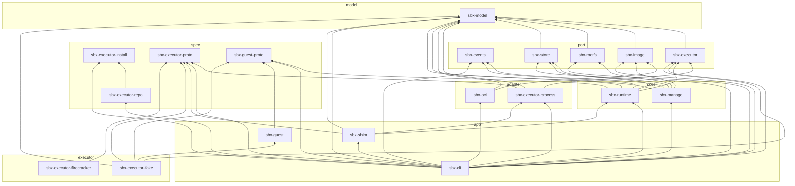

# Crates

`crates/` is split into layer folders. A crate lives at `crates/<layer>/<name>` (only the model sits directly at
`crates/model`), its package is named `sbx-<name>`, and it **only depends on crates in lower layers**. On top of
that, every crate has its own allow list (`RULES` in [`xtask/src/main.rs`](../../xtask/src/main.rs)), and the
modules inside a crate must not form cycles. `cargo xtask check-deps` checks all of it in CI.

## Dependency map

Generated from `cargo metadata` by `cargo xtask deps-doc`. An arrow points from a crate to a crate it uses. Only
normal dependencies are shown: tests may use crates from higher layers (for example the fake executor).

<!-- BEGIN GENERATED: cargo xtask deps-doc -->

| Layer | What lives there |
| --- | --- |
| `model` | Shared data types. No I/O. |
| `spec` | Public protocols and formats that other programs implement. No workspace dependencies beyond `spec`. |
| `port` | What the cores build on: interfaces (executor, image source) and shared building blocks (rootfs, store, events). |
| `adapter` | Implementations of the interfaces in `port`. |
| `core` | Sandbox lifecycle (`runtime`) and images (`manage`). They never pick implementations. |
| `app` | Binaries that pick implementations and put the pieces together. |
| `executor` | Executors: programs that speak the executor protocol and run VMs. |



| Layer | Folder | Crate | Depends on | Used by |
| --- | --- | --- | --- | --- |
| model | [`model`](../../crates/model) | `sbx-model` | – | `sbx-executor`, `sbx-image`, `sbx-rootfs`, `sbx-store`, `sbx-executor-process`, `sbx-oci`, `sbx-manage`, `sbx-runtime`, `sbx-cli`, `sbx-shim`, `sbx-executor-fake` |
| spec | [`spec/executor-install`](../../crates/spec/executor-install) | `sbx-executor-install` | – | `sbx-executor-repo`, `sbx-cli` |
| spec | [`spec/executor-proto`](../../crates/spec/executor-proto) | `sbx-executor-proto` | – | `sbx-executor-process`, `sbx-cli`, `sbx-shim`, `sbx-executor-fake`, `sbx-executor-firecracker` |
| spec | [`spec/executor-repo`](../../crates/spec/executor-repo) | `sbx-executor-repo` | `sbx-executor-install` | `sbx-cli` |
| spec | [`spec/guest-proto`](../../crates/spec/guest-proto) | `sbx-guest-proto` | – | `sbx-runtime`, `sbx-cli`, `sbx-guest`, `sbx-executor-fake` |
| port | [`port/events`](../../crates/port/events) | `sbx-events` | – | `sbx-manage`, `sbx-runtime`, `sbx-cli` |
| port | [`port/executor`](../../crates/port/executor) | `sbx-executor` | `sbx-model` | `sbx-executor-process`, `sbx-runtime`, `sbx-cli`, `sbx-executor-fake` |
| port | [`port/image`](../../crates/port/image) | `sbx-image` | `sbx-model` | `sbx-oci`, `sbx-manage`, `sbx-cli` |
| port | [`port/rootfs`](../../crates/port/rootfs) | `sbx-rootfs` | `sbx-model` | `sbx-manage`, `sbx-cli` |
| port | [`port/store`](../../crates/port/store) | `sbx-store` | `sbx-model` | `sbx-manage`, `sbx-runtime`, `sbx-cli` |
| adapter | [`adapter/executor-process`](../../crates/adapter/executor-process) | `sbx-executor-process` | `sbx-executor`, `sbx-executor-proto`, `sbx-model` | `sbx-cli`, `sbx-shim` |
| adapter | [`adapter/oci`](../../crates/adapter/oci) | `sbx-oci` | `sbx-image`, `sbx-model` | `sbx-cli` |
| core | [`core/manage`](../../crates/core/manage) | `sbx-manage` | `sbx-events`, `sbx-image`, `sbx-model`, `sbx-rootfs`, `sbx-store` | `sbx-cli` |
| core | [`core/runtime`](../../crates/core/runtime) | `sbx-runtime` | `sbx-events`, `sbx-executor`, `sbx-guest-proto`, `sbx-model`, `sbx-store` | `sbx-cli`, `sbx-shim` |
| app | [`app/cli`](../../crates/app/cli) | `sbx-cli` (bin `sbx`) | `sbx-events`, `sbx-executor`, `sbx-executor-install`, `sbx-executor-process`, `sbx-executor-proto`, `sbx-executor-repo`, `sbx-guest-proto`, `sbx-image`, `sbx-manage`, `sbx-model`, `sbx-oci`, `sbx-rootfs`, `sbx-runtime`, `sbx-shim`, `sbx-store` | – |
| app | [`app/guest`](../../crates/app/guest) | `sbx-guest` (bin `sbx-guest`) | `sbx-guest-proto` | `sbx-executor-fake` |
| app | [`app/shim`](../../crates/app/shim) | `sbx-shim` (bin `sbx-shim`) | `sbx-executor-process`, `sbx-executor-proto`, `sbx-model`, `sbx-runtime` | `sbx-cli` |
| executor | [`executor/fake`](../../crates/executor/fake) | `sbx-executor-fake` (bin `sbx-executor-fake`) | `sbx-executor`, `sbx-executor-proto`, `sbx-guest`, `sbx-guest-proto`, `sbx-model` | – |
| executor | [`executor/firecracker`](../../crates/executor/firecracker) | `sbx-executor-firecracker` (bin `sbx-executor-firecracker`) | `sbx-executor-proto` | – |

<!-- END GENERATED -->

### Rules the map doesn't show

- **The two cores don't know each other.** `sbx-runtime` never pulls an image, and `sbx-manage` never starts a
  sandbox. `sbx run` is the CLI calling `manage` first and `runtime` second.
- **Only `sbx-manage` writes to the cache.** `sbx-store` keeps its write API behind the `write` feature, and
  `check-deps` fails if `sbx-runtime` or `sbx-shim` turns it on (`FORBIDDEN_FEATURES`).
- **Cores never pick implementations.** `sbx-runtime` knows the `Executor` trait, not Firecracker. `sbx-manage`
  knows the `ImageSource` trait, not OCI. Only the binaries in `app/` choose and wire implementations.
- **`spec/` stays dependency-free.** These crates describe protocols that other repositories implement, so they
  can't drag the workspace along. `sbx-guest-proto` and `sbx-executor-install` use only the standard library, and
  `sbx-guest` may use nothing but `sbx-guest-proto` and `libc`, to keep the binary inside the VM small.

## model

### `sbx-model` · [`crates/model`](../../crates/model)

The vocabulary every other crate shares: `SandboxSpec`, `SandboxId`, `State`, `ImageConfig`, `Mount`,
`NetworkPolicy` and `AllowRule`, `Signal`, `Platform`, resource limits, and their parsing and validation.

- **No I/O.** Values and the checks on them only. No files, processes or sockets.
- `State::can_transition_to` is the state machine: `creating → created → running ⇄ stopped`, plus
  `creating/created → stopped`.
- `blocking` runs a blocking call on its own thread, so the cores don't depend on a particular async runtime.
- Not used by the guest side (`sbx-guest-proto`, `sbx-guest`), to keep the guest binary small.

## spec

Public protocols and formats. Other programs (an executor in another repository, a static file host, the guest)
implement them, so each crate's top-level doc comment **is** the specification, versioned and written for someone who
has never seen the rest of the code.

### `sbx-guest-proto` · [`crates/spec/guest-proto`](../../crates/spec/guest-proto)

The messages between the host and the guest init, over vsock port `GUEST_PORT` (1024).

- **One connection per operation.** One `exec`, one file copy or one shutdown request opens its own connection,
  so there is no multiplexing. Each connection starts with `Hello`/`HelloAck` (versions must match before 1.0),
  then one request: `Exec`, `CopyIn`, `CopyOut`, `Stat`, `Share`, `EgressListen`, `EgressSlot` or `Shutdown`.
- **Binary encoding** (`codec`, `frame`): one message per length-prefixed frame. Big-endian integers,
  length-prefixed strings and lists.
- **The guest is untrusted.** The host rejects oversized frames before reading them, never preallocates from a length
  the guest sent, and treats trailing bytes, unknown kinds and bad UTF-8 as errors.

### `sbx-executor-proto` · [`crates/spec/executor-proto`](../../crates/spec/executor-proto)

The executor protocol: how `sbx` starts and talks to an executor, and what a VM started by an executor promises the
guest. **This is what a new VMM integration implements.**

- An executor is a program with two subcommands. `capabilities` prints one JSON line (`Capabilities`: protocol version,
  name, architecture, rootfs formats, `live_share`, `custom_kernel`, `max_disks`…). `run` is a control session over line-delimited JSON
  on stdin/stdout: `Launch` → `Started` → (optional `Kill`) → `Exited`. If stdin closes, the executor kills the
  VM, so a crashed `sbx` never leaves an orphan VM.
- **Guest connection:** the executor exposes a Unix socket at `control_socket`. `sbx` writes `CONNECT <port>\n`, reads
  `OK …\n`, and the socket becomes a byte stream to that guest vsock port. This is the Firecracker and Cloud Hypervisor
  convention.
- **Promises to the guest:** the guest init boots as the initrd (`/init`, no `root=`), disks attach in order (`vda`
  rootfs read-only, `vdb` scratch), the kernel command line carries `sbx.hostname=` and `sbx.halt=`, the kernel has
  the listed features (erofs, overlay, vsock, …), and there is no network device.
- `VERSION` changes are incompatible. Readers check `CapabilitiesHeader` first. The version history table is in the
  doc comment.
- Depends only on `serde` and `serde_json`, so another repository can take just this crate.

### `sbx-executor-install` · [`crates/spec/executor-install`](../../crates/spec/executor-install)

How installed executors and adapters sit on disk, and how a `NAME[@VERSION]` picks one of them.
`<data_dir>/executors/<name>/<version>/` is either self-contained (`sbx-executor` at the top, plus whatever files it
finds next to itself) or a **VMM package** (no `sbx-executor`, and a `.sbx-adapter` file naming the adapter that runs
it). A `default` file holds `<name>@<version>`. Adapters use the same layout under `<data_dir>/adapters`.

- Installs copy into a staging directory, run the caller's check (protocol version, architecture), then rename, so
  there is never a half-installed executor. The first one installed becomes the default.
- Name and version rules (`[A-Za-z0-9._+-]`). A version is a **main version** and a **patch** (before and after the
  first `-` or `+`): `wick@1.18.0` means the newest patch of 1.18.0, the full version means exactly that,
  and no version or `@latest` means the highest. `version_cmp` orders them like semver, with `+` patches above the
  plain version (`1.18.0` < `1.18.0+wick.1` < `1.18.0+wick.10`).
- Standard library only.

### `sbx-executor-repo` · [`crates/spec/executor-repo`](../../crates/spec/executor-repo)

Static executor repositories (schemas 1 and 2) and the client that reads them. A repository is a directory of
files, so GitHub Pages, S3 or `file://` all work.

- `index.json` (schema 1) lists executors → versions → per-platform artifacts (`os`/`architecture` in OCI terms,
  `url`, `sha256`, `size`). Unknown fields are ignored, and anything malformed rejects the whole index.
- `v2/index.json` (schema 2) adds `adapters`, and lets an executor version name an `adapter` instead of a `protocol`
  (a VMM package). The client reads `v2/index.json` first and falls back to `index.json` only when it doesn't exist,
  so one repository can serve old and new `sbx`.
- Only `https`, `file` and loopback `http`. The download must match `sha256` and `size` before unpacking, and
  unpacking refuses links, device files, absolute paths and `..` (`unpack`).
- `index::pick` chooses across repositories in priority order, for this host's platform and protocol version, with
  the same main-version rule as installed executors. When nothing matches, it says why (no such name, no such
  version, no build for this platform, wrong protocol).
- Modules: `error`, `location`, `platform` → `index`, `sources`, `unpack` → `fetch`.

## port

What the cores build on: the interfaces they call (`executor`, `image`), and the shared building blocks
(`rootfs`, `store`, `events`).

### `sbx-events` · [`crates/port/events`](../../crates/port/events)

The event log behind `sbx events`: a directory of JSON Lines files that any process can append to and follow.
There is no daemon, so the process that changes something appends the event itself.

- `Log::append` takes a file lock, stamps the time and writes one whole line, so concurrent writers never interleave.
- A generation that reaches 1 MiB rolls over to the next. Only the previous one is kept, so old events are dropped
  by design.
- `Reader` returns what is there and `None` at the end; following means calling it again. Half-written last lines
  wait, broken lines are skipped, and a reader that fell more than a generation behind jumps to what is left.
- It decides nothing about what is recorded or where. The cores choose that (see below). Depends only on `serde`
  and `serde_json`.

### `sbx-executor` · [`crates/port/executor`](../../crates/port/executor)

The `Executor` trait the runtime core uses: `capabilities`, `launch` (returns a `VmHandle` with `wait` and `kill`) and
`connect` (a byte stream to a guest vsock port).

- Executor features are exposed through `Capabilities`, not hidden. The runtime refuses a request the executor can't
  serve instead of quietly doing something else.
- It doesn't know the guest messages. It only opens streams. Asking the guest to shut down is the runtime's job.
- Implemented by `sbx-executor-process` (external executors) and `sbx-executor-fake` (tests).

### `sbx-image` · [`crates/port/image`](../../crates/port/image)

The `ImageSource` trait: resolve a reference to a config and a list of layers, and download a layer. No OCI types
here, so widening OCI support never touches the cores. Implemented by `sbx-oci`.

### `sbx-rootfs` · [`crates/port/rootfs`](../../crates/port/rootfs)

Turns image layers into a root filesystem disk image, in two steps:

1. **Merge** the layers into a `MergedTree` with the OCI layer rules (whiteouts, opaque directories, hard links,
   directory replacement). The rules are listed at the top of `lib.rs`.
2. **Write** the tree with a `RootfsBuilder` for one format. EROFS (`erofs` feature) is the only one today.

Nothing is ever unpacked onto the host filesystem. Paths are `/`-separated strings, because macOS and Windows
filesystems are case-insensitive and an unprivileged user can't create device files or other owners' files.

### `sbx-store` · [`crates/port/store`](../../crates/port/store)

The cache directory: layout, locks and reads. Writes are behind the `write` feature, which only `sbx-manage` turns on.

```text
<cache_dir>/
  blobs/sha256/<hex>              layers, stored only after their digest is checked
  images/<hex>/image.json         image record
  images/<hex>/rootfs.erofs       prepared root filesystem
  images/<hex>/kernel             the image's own kernel, if it has one
  images/<hex>/.lock              in-use lock (a running sandbox holds it shared)
  guest/<version>/<arch>/initramfs
  refs.json                       reference → image ID
  events/images/                  image events (sbx-events), appended by sbx-manage
```

- Every write goes to a temporary file and is renamed into place, and each image has its own lock file. Several
  processes can therefore share one cache.
- **In-use protection:** whoever owns a running VM holds a shared lease on its image (`Store::lease`), and removing
  an image needs the exclusive lock. Because the lock lives in the cache, sandboxes in any `data_dir` are protected.

## adapter

### `sbx-oci` · [`crates/adapter/oci`](../../crates/adapter/oci)

`ImageSource` for OCI registries (Distribution Spec and Image Spec).

- `reference`: Docker-style reference parsing (`alpine` → `docker.io/library/alpine:latest`).
- `registry`: anonymous and Bearer-token auth, OCI and Docker v2 manifests.
- `manifest`: picks `linux/<host arch>` from an index, checks every document's sha256 and that the config matches the
  layers.
- `scope`: exactly which fields are applied, and which are ignored on purpose.

OCI types never leave this crate. They become `ImageConfig` and a layer list.

### `sbx-executor-process` · [`crates/adapter/executor-process`](../../crates/adapter/executor-process)

`Executor` for any program that speaks the executor protocol. This is how `sbx` runs every real VMM.

- `ProcessExecutor::new` runs `<executor> capabilities` once, for at most `CAPABILITIES_TIMEOUT` (30 s) and two
  `MAX_LINE`s of output; past either it kills the executor and fails, so a hung executor can't hold the install
  lock. `launch` starts `<executor> run`, sends `Launch` and
  waits for `Started`. The executor's stderr goes to the sandbox's `executor.log`.
- The `VmHandle` holds the executor's stdin. Dropping it sends `Kill` (and kills the process if needed), and if `sbx`
  dies, the closed stdin makes the executor stop the VM.
- `ConnectOnly` connects to a running sandbox's guest without an executor binary (used by `exec`, `cp` and `stop`
  from another process).

## core

### `sbx-runtime` · [`crates/core/runtime`](../../crates/core/runtime)

The sandbox lifecycle: `Runtime::create`, `resolve` (ID, name or ID prefix) and `list`, and on a `Sandbox`: `start`,
`exec`, `copy_in`/`copy_out`, `stop`, `kill`, `wait` and `delete`. One sandbox is one VM and one image.

- **Explicit:** `create` fails if the image or its rootfs isn't in the cache. It never pulls. A request the
  executor can't serve fails at create time (`validate`). It never falls back.
- **Docker semantics:** the main process (`spec.process`) defines the sandbox's life, exit codes follow Docker
  (128 + signal, 137 when the VM went away), and `cp` targets follow `docker cp` (`cpplan`). `process` merges the
  image config with the caller's values the way `docker run` does.
- **Ownership:** the process that starts a VM owns it and holds `owner.lock`. If that process dies, the VM dies too
  (executor protocol rule 5), and everyone else sees `stopped`. Detached sandboxes are owned by `sbx-shim`.
- **Records** (`records`): `<data_dir>/sandboxes/<id>/` holds `spec.json`, `state.json`, `scratch.img`, `owner.lock`
  and `logs/`. Sandboxes are created in a temporary directory and renamed into place, and deleted by renaming first,
  so half-created and half-deleted sandboxes never show up in `list`. Names are files under `<data_dir>/names/`,
  claimed with a hard link so two processes can't take the same name.
- **Events:** every time it records a sandbox as created, running, stopped or removed, it appends an event to
  `<data_dir>/events/sandboxes`. A failed append never fails the operation.
- **Egress** (`egress`): runs in the VM's owner. It checks each connection the guest proxy asks for against the
  allow list, refuses names that resolve to private addresses, and relays bytes.
- Modules: `lib` → `egress` → `client` → `hostfs`, `records` → `process`, `validate`, `cpplan`, `chan` → `error`.

### `sbx-manage` · [`crates/core/manage`](../../crates/core/manage)

Images and the cache: `pull` (with `pull_with` for progress), `prepare`, `images`, `untag` and `remove`, plus
`install_guest_init`, which puts the embedded guest init into the cache.

- `pull` only downloads. It skips layers already present, checks each layer's digest itself, and writes the image
  record and reference only after every layer is stored.
- `prepare` builds the rootfs for one format, unless it already exists. It checks diff IDs, extracts the image's own
  kernel when the image is labelled with one, and holds a shared lock so the image can't be removed meanwhile.
- `remove` deletes an image and the blobs nothing else uses, and refuses while a running sandbox uses the image.
  Whether a *stopped* sandbox's image may go is the caller's decision, because this crate doesn't know `data_dir`.
- After a pull, a prepare that built something, an untag or a delete, it appends an event to
  `<cache_dir>/events/images`.
- It never cleans up on its own.

## app

### `sbx-cli` · [`crates/app/cli`](../../crates/app/cli) · bin `sbx`

The Docker-style CLI and the MCP server. There is no domain logic here: it parses, picks implementations, calls the
cores in order, and prints.

| Module | Job |
| --- | --- |
| `cli`, `parse` | clap definitions, parsing of `-e`, `--env-file`, `--mount`, `--allow`, `cp` endpoints… |
| `commands` | the command list and groups that `sbx help` prints |
| `app` | one function per command: wires `sbx-manage`, `sbx-runtime`, `sbx-oci` and the executor together |
| `attach` | attached runs: stdin, TTY raw mode, resize, signals |
| `executors` | `sbx executor …`: install, use, current, which, rm, prune, adapters, repositories (`sbx-executor-install`, `sbx-executor-repo`) |
| `choose` | which executor a command runs: `--executor`, the sandbox's pin, `.sbx-executor`, the default, `PATH` |
| `output` | the public `--format json` types, `--jq` (built-in jaq), JSON errors, and the generated [cli-output.md](cli-output.md) |
| `filter` | `--filter KEY=VALUE` for `ps`, `images` and `events` (Docker's rules), no I/O |
| `tui` | `sbx tui`: `keys` (the key list), `model` (keys to `sbx` command lines, no I/O), `view` (drawing), and `mod` (runs `sbx` children, hands over the terminal) |
| `mcp` | `sbx mcp`: the same operations as MCP tools over stdio, with progress notifications |
| `complete` | `sbx completion` and `COMPLETE=<shell> sbx`: sandbox names and IDs, image references and installed executors as tab candidates, read-only |
| `behavior` | exit codes, `--pull`, `rmi` protection, time formatting, and `DOCKER_DIFFERENCES` |
| `dirs` | default `data_dir`, `cache_dir` and `socket_dir` per OS |
| `guest` | the embedded guest initramfs (empty in a plain `cargo build`) |
| `host`, `progress` | `sbx info` host checks, and the pull progress line |

The end-to-end tests ([`tests/e2e.rs`](../../crates/app/cli/tests/e2e.rs)) run the real `sbx` binary against the fake
executor.

### `sbx-shim` · [`crates/app/shim`](../../crates/app/shim) · bin `sbx-shim`

The owner of a detached sandbox (`run -d`, `start`), one process per sandbox, with no daemon.

- `launch` starts the shim in its own process group (so Ctrl-C in your terminal doesn't reach it) and waits for one
  line: `ready` or `error <reason>`.
- `serve` (the shim process) starts the sandbox through `sbx-runtime`, so it owns the VM. It writes the main
  process's output to `logs/main.log` (`log`: each record carries the time it arrived; files from before timestamps are
  still read and appended to), serves `sbx attach` on a socket, turns SIGTERM and SIGINT into a stop, and exits
  when the main process does (deleting the sandbox first with `--rm`).
- Everything else (`exec`, `cp`, `stop`) talks to the guest directly through `sbx-runtime`. The shim doesn't need
  to be involved.

### `sbx-guest` · [`crates/app/guest`](../../crates/app/guest) · bin `sbx-guest`

The guest init: PID 1 inside the VM, Linux only, statically linked. Everything it receives comes from the host,
but everything it runs is untrusted user code, so the host never trusts what it sends.

```text
boot                         PID 1 and the connection-handling process (Linux)
server                       one connection: version check, dispatch
exec   copy   egress  dns    one request each (egress: HTTP proxy; dns: instant NXDOMAIN)
wire   passwd  mkfs  cmdline messages, user lookup, formatting scratch, kernel command line
sys                          system calls (the only place with unsafe)
```

Everything below `boot` works on plain streams and files, so it's unit-tested on the host. The tests that need real
mounts run as root in a privileged container in CI (`SANDBOX_PRIVILEGED_TESTS=1`).

## executor

### `sbx-executor-firecracker` · [`crates/executor/firecracker`](../../crates/executor/firecracker) · bin `sbx-executor-firecracker`

The `firecracker` adapter. It is shipped as an adapter package: `sbx-executor` next to the default `kernel`. The
`firecracker` binary comes from a VMM package (such as `wick`), whose directory `sbx` passes in `SBX_EXECUTOR_VMM_DIR`.

- It uses only Firecracker's public interface (`firecracker --no-api --config-file`, vsock `CONNECT`), so the same
  adapter runs upstream Firecracker on Linux/KVM and [wick](https://github.com/toollyst/wick)
  on macOS/Hypervisor.framework.
- `settings` finds `firecracker` (`SBX_FIRECRACKER`, then the VMM package directory, then next to itself, then
  `PATH`) and the kernel (`SBX_FIRECRACKER_KERNEL`, then next to itself). `config` writes the VM config (initrd,
  disks, vsock, kernel command line). `session` runs the protocol session and writes the config file next to the
  control socket as a new `0600` file.
- It knows nothing about `sbx` except the executor protocol (`sbx-executor-proto` is its only workspace dependency).

### `sbx-executor-fake` · [`crates/executor/fake`](../../crates/executor/fake) · bin `sbx-executor-fake`

A test executor that boots nothing. It serves the guest socket and runs `sbx-guest`'s connection handling on the host,
so the runtime exchanges the real messages.

- `FakeExecutor` is an in-process `Executor` for the runtime's unit tests. The `sbx-executor-fake` binary speaks the
  executor protocol, so the CLI tests go through `sbx-executor-process` exactly like a real executor.
- [`tests/conformance.rs`](../../crates/executor/fake/tests/conformance.rs) drives the `sbx-executor-fake` binary
  through `sbx-executor-process`, including misbehaving executors made from wrapper scripts. It is the model for
  testing a new executor against the protocol.
- It differs from a VM in the obvious ways: processes run on the host as you, paths are host paths, and shares are
  symlinks. The list is in its `lib.rs`.

## Adding a crate

1. Put it in the right layer folder, at `crates/<layer>/<name>`, with the package name `sbx-<name>`.
2. Add it to `members` and `[workspace.dependencies]` in the root `Cargo.toml`.
3. Add a rule for it to `RULES` in `xtask/src/main.rs`, listing exactly which workspace crates it may use.
4. Write the crate's `//!` doc: what it does, what it must not know, and its dependencies.
5. Run `cargo xtask deps-doc`, then `cargo xtask check-deps`, and add a section for it on this page.
