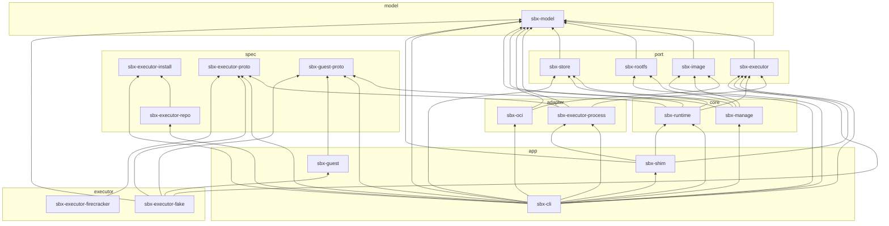

# Crates

<!-- BEGIN GENERATED: cargo xtask deps-doc -->

| Layer | What lives there |
| --- | --- |
| `model` | Shared data types. No I/O. |
| `spec` | Public protocols and formats that other programs implement. No workspace dependencies beyond `spec`. |
| `port` | What the cores build on: interfaces (executor, image source) and shared building blocks (rootfs, store). |
| `adapter` | Implementations of the interfaces in `port`. |
| `core` | Sandbox lifecycle (`runtime`) and images (`manage`). They never pick implementations. |
| `app` | Binaries that pick implementations and put the pieces together. |
| `executor` | Executors: programs that speak the executor protocol and run VMs. |

| Layer | Folder | Crate | Depends on | Used by |
| --- | --- | --- | --- | --- |
| model | [`model`](../../crates/model) | `sbx-model` | – | `sbx-executor`, `sbx-image`, `sbx-rootfs`, `sbx-store`, `sbx-executor-process`, `sbx-oci`, `sbx-manage`, `sbx-runtime`, `sbx-cli`, `sbx-shim`, `sbx-executor-fake` |
| spec | [`spec/executor-install`](../../crates/spec/executor-install) | `sbx-executor-install` | – | `sbx-executor-repo`, `sbx-cli` |
| spec | [`spec/executor-proto`](../../crates/spec/executor-proto) | `sbx-executor-proto` | – | `sbx-executor-process`, `sbx-cli`, `sbx-executor-fake`, `sbx-executor-firecracker` |
| spec | [`spec/executor-repo`](../../crates/spec/executor-repo) | `sbx-executor-repo` | `sbx-executor-install` | `sbx-cli` |
| spec | [`spec/guest-proto`](../../crates/spec/guest-proto) | `sbx-guest-proto` | – | `sbx-runtime`, `sbx-cli`, `sbx-guest`, `sbx-executor-fake` |
| port | [`port/executor`](../../crates/port/executor) | `sbx-executor` | `sbx-model` | `sbx-executor-process`, `sbx-runtime`, `sbx-cli`, `sbx-shim`, `sbx-executor-fake` |
| port | [`port/image`](../../crates/port/image) | `sbx-image` | `sbx-model` | `sbx-oci`, `sbx-manage`, `sbx-cli` |
| port | [`port/rootfs`](../../crates/port/rootfs) | `sbx-rootfs` | `sbx-model` | `sbx-manage`, `sbx-cli` |
| port | [`port/store`](../../crates/port/store) | `sbx-store` | `sbx-model` | `sbx-manage`, `sbx-runtime`, `sbx-cli` |
| adapter | [`adapter/executor-process`](../../crates/adapter/executor-process) | `sbx-executor-process` | `sbx-executor`, `sbx-executor-proto`, `sbx-model` | `sbx-cli`, `sbx-shim` |
| adapter | [`adapter/oci`](../../crates/adapter/oci) | `sbx-oci` | `sbx-image`, `sbx-model` | `sbx-cli` |
| core | [`core/manage`](../../crates/core/manage) | `sbx-manage` | `sbx-image`, `sbx-model`, `sbx-rootfs`, `sbx-store` | `sbx-cli` |
| core | [`core/runtime`](../../crates/core/runtime) | `sbx-runtime` | `sbx-executor`, `sbx-guest-proto`, `sbx-model`, `sbx-store` | `sbx-cli`, `sbx-shim` |
| app | [`app/cli`](../../crates/app/cli) | `sbx-cli` (bin `sbx`) | `sbx-executor`, `sbx-executor-install`, `sbx-executor-process`, `sbx-executor-proto`, `sbx-executor-repo`, `sbx-guest-proto`, `sbx-image`, `sbx-manage`, `sbx-model`, `sbx-oci`, `sbx-rootfs`, `sbx-runtime`, `sbx-shim`, `sbx-store` | – |
| app | [`app/guest`](../../crates/app/guest) | `sbx-guest` (bin `sbx-guest`) | `sbx-guest-proto` | `sbx-executor-fake` |
| app | [`app/shim`](../../crates/app/shim) | `sbx-shim` (bin `sbx-shim`) | `sbx-executor`, `sbx-executor-process`, `sbx-model`, `sbx-runtime` | `sbx-cli` |
| executor | [`executor/fake`](../../crates/executor/fake) | `sbx-executor-fake` (bin `sbx-executor-fake`) | `sbx-executor`, `sbx-executor-proto`, `sbx-guest`, `sbx-guest-proto`, `sbx-model` | – |
| executor | [`executor/firecracker`](../../crates/executor/firecracker) | `sbx-executor-firecracker` (bin `sbx-executor-firecracker`) | `sbx-executor-proto` | – |

<!-- END GENERATED -->
